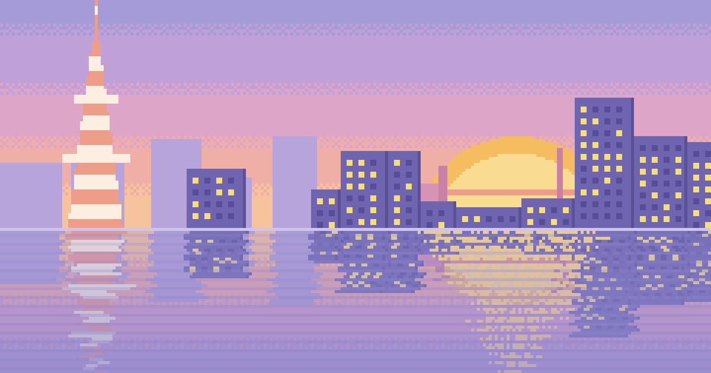

# jonathanday.vercel.app

My design portfolio: three case studies and a playable demo of BigCity, a one-knob audio plugin I designed and shipped.



**Live:** https://jonathanday.vercel.app

## What's in here

- **Pixel city hero** (`src/lib/pixel-city/`): three.js with WebGPU (TSL shaders), falling back to WebGL2 if the first WebGPU frame fails. Loads only on the home page, after a static poster image. Scrolling moves it toward night, clicking the water sends ripples, and it holds still for people who've turned on reduced motion.
- **BigCity demo** (`src/lib/bigcity-plugin.ts`, `src/components/BigCityDemo.astro`): the plugin's real interface, ported from its JUCE C++ source to Canvas 2D: knob, skyline keyframes, lit windows, water shimmer, seven-segment readout and bypass fade. Real HTML controls sit over the drawn ones, so it works with a keyboard, a screen reader and touch.
- **Demo audio** (`src/lib/bigcity-player.ts`): Web Audio plays five renders of the same loop, one per City size step, and crossfades between them with equal-power gains as the knob moves.
- **Split-flap metrics** on the Lattice case study.
- **Accessibility:** every page passes axe with no violations, every control works by keyboard, and touch targets are at least 48 px.

## How it was built

Designed in Figma and built with Claude Code. I made the design and product decisions, chose the stack, wrote the copy, and reviewed every change on the live site before it shipped. Claude Code wrote most of the implementation, which is why most commits are authored by Claude.

## Run it

```bash
npm install
npm run dev        # http://localhost:4321
npm run build      # type check + production build
```

## Where things live

| To change | Edit |
| --- | --- |
| Name, title, email, links, home and about copy | `src/site.ts` |
| Case studies (copy and facts) | `src/content/work/*.md` |
| Case study images | `public/work/<slug>/`, referenced from the Markdown |
| BigCity demo audio | `public/audio/`, listed in `bigcityDemo.audio` in `src/site.ts` |
| BigCity demo art (from the plugin's `assets/`) | `public/plugin/`; drawing code ported from `Source/` in `src/lib/bigcity-plugin.ts` |
| Colours, type, spacing | `src/styles/global.css` |
| The city itself | `src/lib/pixel-city/` |

The BigCity demo appears wherever `bigcity.md` contains `<div data-demo></div>`.
